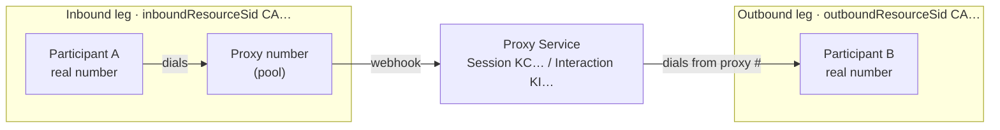
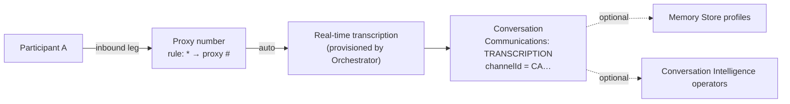
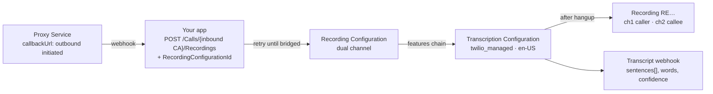

# Twilio Proxy: Recording & Transcription Quickstart

A small Node/Express app with a one-page UI for testing two ways to capture what's said on a [Twilio Proxy](https://www.twilio.com/docs/proxy) masked-number call:

- **Option 1: Conversation Orchestrator.** A voice capture rule on the proxy number gives real-time transcription written into Conversations. No code runs in the call path.
- **Option 2: Recording API + Batch Transcription.** A REST-started, dual-channel recording on the inbound call is chained to a Transcription Configuration, so the transcript arrives automatically after hangup.

The UI creates two-party Proxy sessions and shows each interaction's inbound and outbound Call SIDs. It lets you toggle either option on and off. It also lets you download the recording and the batch transcript, and load the Orchestrator transcript for each call leg.

A styled one-page version of this write-up is in [docs/proxy-recording-transcription-overview.html](docs/proxy-recording-transcription-overview.html).

## At a glance

| | Option 1 · Conversation Orchestrator | Option 2 · Recording + Batch Transcription |
|---|---|---|
| Output | Real-time utterances stored as Communications on a Conversation | Dual-channel MP3 recording, plus a post-call transcript (sentences, word timings, confidence) |
| Latency | During the call | About 1 minute after hangup |
| Code in the call path | None | One REST call to start recording |
| Audio kept | No | Yes |
| Downstream | Memory profiles, Conversation Intelligence operators | Your webhook (optionally also a Conversation Configuration) |
| Watch out for | Capture **inbound only**, or each call is transcribed twice | Account must be enabled for v3 transcription (see error `46009` below) |

## How a Proxy voice call is built

When participant A dials their assigned proxy number, Proxy answers and dials participant B from the same proxy number. That makes **two call legs, each with its own Call SID**, grouped under one Proxy Interaction (`KI…`). Both legs carry the full bridged audio.



Proxy sends `interceptCallbackUrl` once per interaction, before it dials B. It sends `callbackUrl` on status changes; for the outbound leg those are `initiated` and then `completed`.

## Option 1: Conversation Orchestrator capture rules

Add a VOICE capture rule that matches the proxy number to a Conversation Configuration. Twilio attaches real-time transcription to matching calls and writes each utterance into a Conversation as a `TRANSCRIPTION` Communication.



**Configure:**

- A Memory Store, which the configuration requires.
- A Conversation Configuration linked to the Memory Store.
- One **inbound-only** VOICE capture rule per proxy number:

```json
"channelSettings": {
  "VOICE": {
    "captureRules": [
      { "from": "*", "to": "+15551234567", "metadata": { "callType": "PSTN" } }
    ]
  }
}
```

**What we learned:**

- **Don't use the usual bidirectional rule pair.** A `proxy → *` rule also matches the outbound leg Proxy places. You end up with two conversations and two transcription streams per call, so every utterance is transcribed and billed twice. The inbound leg alone already contains both speakers.
- To find a call's transcript, call `GET /v2/Conversations?channelId=CA…`, then `/Conversations/{id}/Communications`.
- On voice Communications the Call SID is in `channelId`. `resourceId` is a transcription ID (`GT…#n`).
- Utterance text is in `content.text`. `content.transcription` holds metadata such as engine and confidence.
- On each leg, the far party is labeled with the proxy number, not their real number.
- Configuration updates are a full-body `PUT /v2/ControlPlane/Configurations/{id}`, and Twilio applies them asynchronously.

## Option 2: Recording API + chained Batch Transcription

When Proxy reports the outbound leg, the app starts a recording on the **inbound** Call SID with a `RecordingConfigurationId`. That Recording Configuration is chained to a Transcription Configuration, so Twilio transcribes the finished recording and posts the transcript to your webhook.



**Configure:**

```http
POST https://voice.twilio.com/v2/Configurations/Transcription
{
  "unique_name": "proxy_recording_quickstart",
  "configuration": {
    "configurationType": "Transcription",
    "transcriptionEngine": "twilio_managed",
    "language": "en-US",
    "transcriptionStatusCallback": { "url": "https://<your-host>/webhooks/transcription", "method": "POST" },
    "participantDefaults": [
      { "audioChannelIndex": 1, "type": "CUSTOMER" },
      { "audioChannelIndex": 2, "type": "HUMAN_AGENT" }
    ]
  }
}

POST https://voice.twilio.com/v2/Configurations/Recording
{
  "unique_name": "proxy_recording_quickstart",
  "configuration": {
    "configurationType": "Recording",
    "compositionPolicy": { "channels": "dual", "trim": "do-not-trim" },
    "callRecordingStatusCallback": {
      "url": "https://<your-host>/webhooks/recording",
      "method": "POST",
      "events": ["in-progress", "completed"]
    },
    "features": [
      { "type": "transcriptionConfiguration", "featureId": "voice_transcriptionconfiguration_…" }
    ]
  }
}
```

**What we learned:**

- **The intercept webhook is too early.** Starting a recording from `interceptCallbackUrl` fails with `21220` ("Requested resource is not eligible for recording") because Proxy hasn't bridged B yet. Proxy's `callbackUrl` only reports the outbound leg as `initiated` and then `completed`, with no `in-progress`. So the app starts on `initiated` and retries every 2 seconds until the call becomes recordable, giving up when the call ends or after 60 seconds.
- Record the **inbound** leg. With dual channel, A is on channel 1 and B is on channel 2.
- Error `46009` ("Account is a v2 transcription customer and may not use this API") means the account is flagged for Voice Intelligence v2. Twilio support has to enable v3 before you can create Transcription Configurations.
- The transcript only goes to your webhook, so store it yourself. Or set a `conversationConfigurationId` on the Transcription Configuration to keep it in Orchestrator.
- Recording media requires account auth. Serve downloads through your backend.
- Proxy's interaction record leaves the inbound leg's status at `in-progress` after hangup, so read the real status from the Calls API.

## Webhooks

`npm run setup` sets all of these.

| Resource | Setting | Points to | Used for |
|---|---|---|---|
| Proxy Service | `interceptCallbackUrl` | `/webhooks/proxy/intercept` | Logging only (too early to record) |
| Proxy Service | `callbackUrl` | `/webhooks/proxy/callback` | Option 2: start recording when outbound is `initiated` |
| Recording Configuration | `callRecordingStatusCallback` | `/webhooks/recording` | Option 2: recording SID and status |
| Transcription Configuration | `transcriptionStatusCallback` | `/webhooks/transcription` | Option 2: final transcript |
| Conversation Configuration | VOICE `captureRules` | no webhook | Option 1: `* → proxy #` only, toggled from the UI |

## Run it

**Prerequisites:**

- Node 18 or later.
- [ngrok](https://ngrok.com/) or another tunnel.
- A Twilio account with Proxy, Conversation Orchestrator and v3 Batch Transcription enabled.
- At least one voice-capable Twilio number for the Proxy pool, in the **same country as your participants**. Proxy won't hand a US participant a Canadian pool number.

1. `npm install`
2. `ngrok http 3000` and copy the HTTPS URL.
3. `cp .env.example .env` and set:
   - `TWILIO_ACCOUNT_SID` and `TWILIO_AUTH_TOKEN`
   - `PROXY_NUMBER_SIDS`: comma-separated `PN…` SIDs for the pool. Adding a number to the pool overwrites its voice and SMS webhooks.
   - `PUBLIC_BASE_URL`: your tunnel URL.
   - Optionally `MEMORY_STORE_ID` and `CONVERSATION_CONFIGURATION_ID` to reuse existing resources.
4. `npm run setup`. It creates or updates the Proxy Service, attaches the numbers, and creates the Transcription Configuration, Recording Configuration, Memory Store and Conversation Configuration, writing their IDs to `.env`. It's safe to re-run, and you should whenever the tunnel URL changes.
5. `npm start`, then open http://localhost:3000.

**Test a call:**

1. Create a session with two real phone numbers.
2. Turn on Option 1, Option 2, or both.
3. From participant A's phone, call the proxy number shown next to A. Proxy connects you to B.
4. Talk for a bit and hang up.
   - **Option 2:** the recording SID appears once B answers, and it becomes a download link when the recording completes. The batch transcript appears about a minute later, with show and download buttons.
   - **Option 1:** click "load inbound" to pull the utterances Orchestrator captured.

## Project layout

| Path | Purpose |
|---|---|
| `scripts/setup.js` | Idempotent provisioning CLI; writes resource IDs to `.env` |
| `src/server.js` | Express app: UI API, Proxy, recording and transcription webhooks, recording and transcript downloads |
| `src/orchestrator.js` | Toggles the VOICE capture rule; fetches Orchestrator transcripts by Call SID |
| `src/store.js` | In-memory recording and transcript state, keyed by Call SID |
| `src/twilio.js` | Twilio SDK client plus a small JSON `fetch` helper for the v2/v3 APIs |
| `public/index.html` | Single-page UI |

## Notes

- This is a demo harness. Recording and transcript state is held in memory and resets on restart. There's no auth on the UI, and webhook signatures aren't validated.
- The Option 1 toggle replaces all VOICE capture rules on the configured Conversation Configuration. Other channels are left alone.
